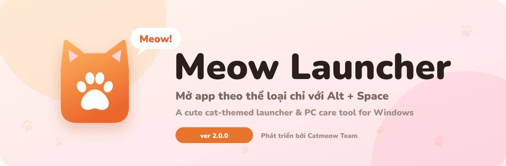
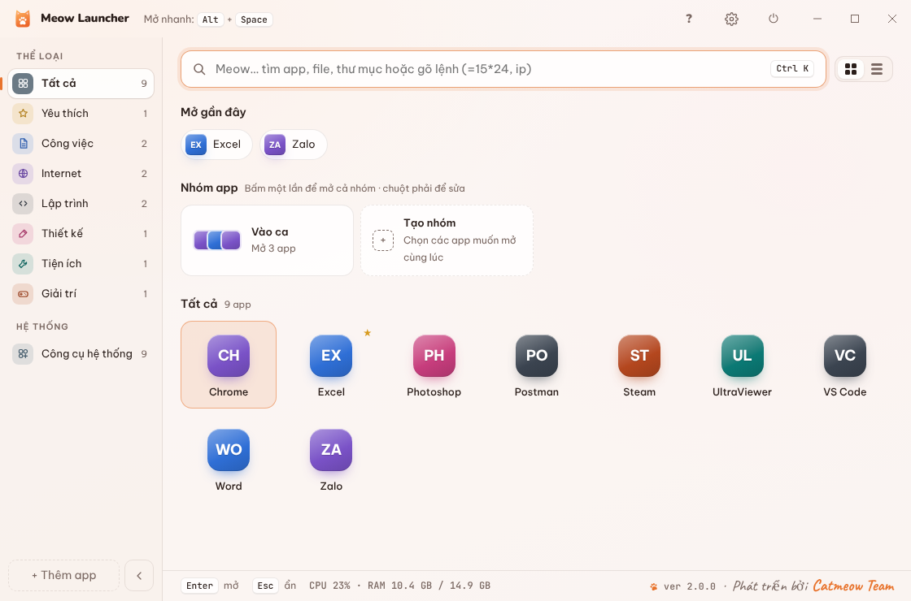
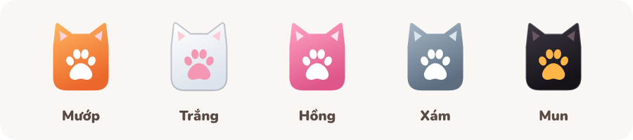
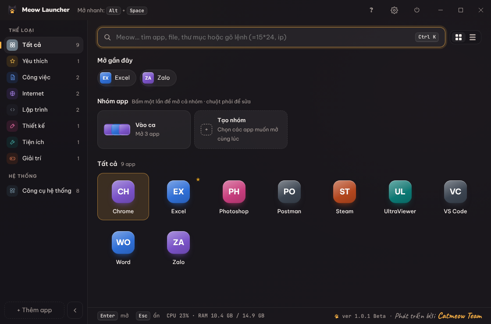
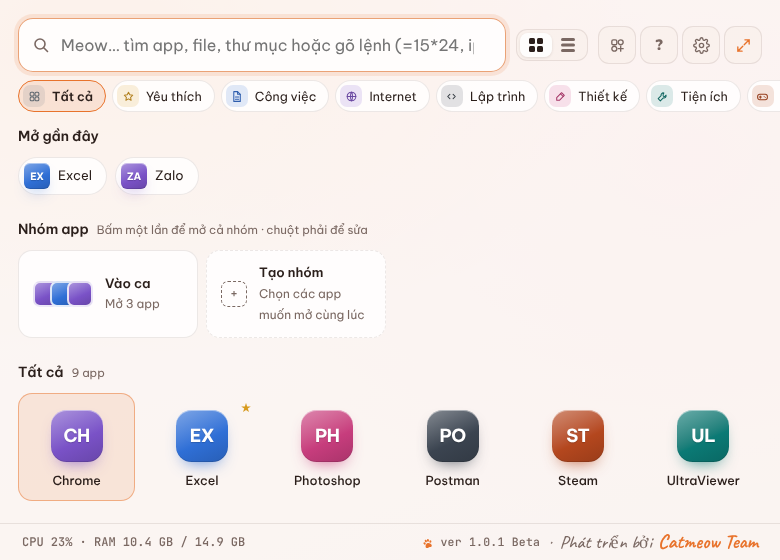
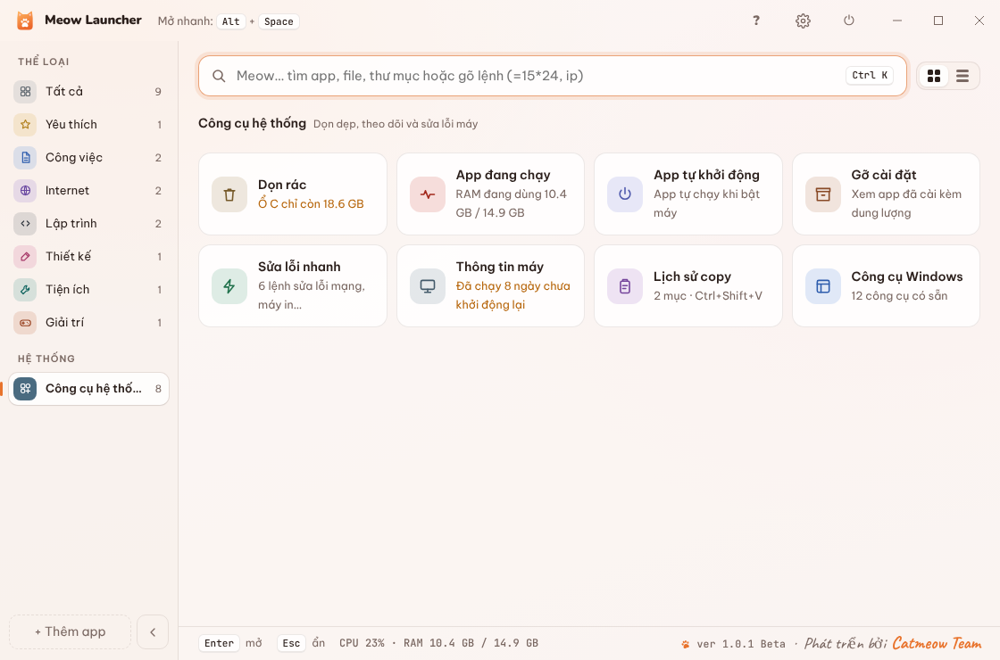
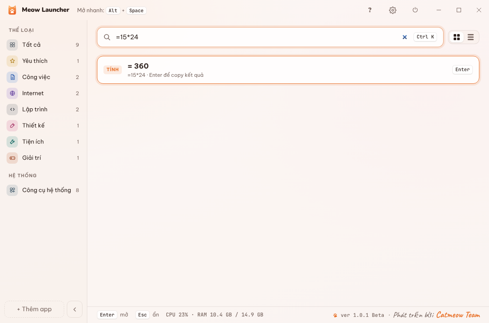
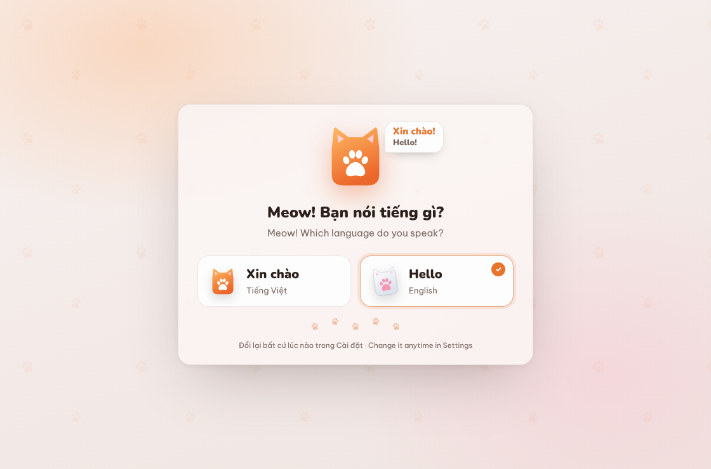
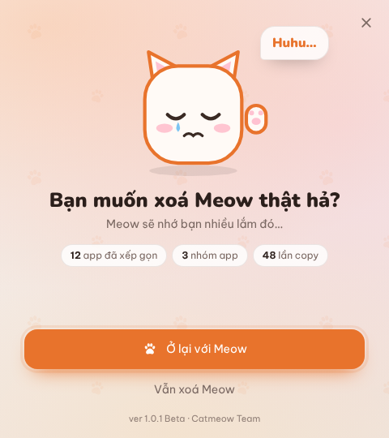
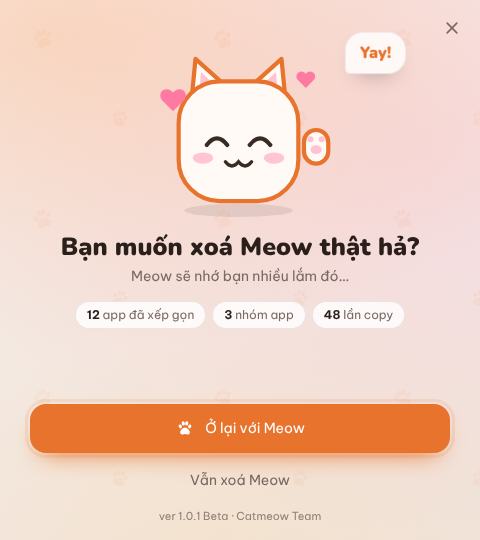

<p align="center">
  
</p>

<p align="center">
  <a href="https://github.com/CatMeowTeam/MeowLauncher/releases/latest"></a>
  
  
</p>

<p align="center">
  <b>Tiếng Việt</b> · <a href="#-english">English</a>
</p>

---

## 🐱 Meow Launcher là gì?

Màn hình chính đầy shortcut? Mỗi lần mở app phải lục tung Start Menu?
**Meow Launcher** gom hết app vào một cửa sổ xinh xắn, xếp theo thể loại. Nhấn <kbd>Alt</kbd> + <kbd>Space</kbd> ở bất kỳ đâu, gõ vài chữ, <kbd>Enter</kbd> là xong.

Kèm theo là một hộp đồ nghề nho nhỏ để chăm sóc máy: dọn rác, tắt app tốn RAM, quản lý app khởi động cùng Windows, sửa lỗi mạng và máy in.

<p align="center">
  
</p>

## ✨ Tính năng

| | |
|---|---|
| 🗂️ **Mở app theo thể loại** | Công việc, Internet, Lập trình, Thiết kế, Tiện ích, Giải trí… tự tạo thêm danh mục riêng |
| 🐾 **Kéo thả là xong** | Kéo shortcut từ màn hình chính vào, Meow tự đoán thể loại và dọn màn hình chính cho gọn (khôi phục lại được) |
| 🔎 **Tìm mọi thứ** | Tìm app, file, thư mục. Gõ `=15*24` để tính, `ip` để xem IP, `tắt máy` để tắt máy |
| 👯 **Nhóm app** | Một cú bấm mở cả nhóm, ví dụ “Vào ca làm việc” mở Chrome, Excel, Zalo cùng lúc |
| 📋 **Lịch sử copy** | <kbd>Ctrl</kbd> + <kbd>Shift</kbd> + <kbd>V</kbd> xem lại 50 lần copy gần nhất, ghim mục hay dùng |
| 🧹 **Dọn rác** | Tệp tạm, thùng rác, bộ nhớ đệm trình duyệt. Quét trước, xác nhận rồi mới xoá |
| 🏃 **App đang chạy** | Xem CPU, RAM từng app, tắt app bị treo mà không mất file chưa lưu |
| 🚀 **App tự khởi động** | Tắt bớt app chạy cùng Windows để bật máy nhanh hơn |
| 🛠️ **Sửa lỗi nhanh** | Xoá DNS, làm mới IP, reset mạng, sửa máy in kẹt lệnh, khởi động lại Explorer |
| 💻 **Thông tin máy** | Cấu hình, IP, MAC, ổ đĩa. Copy gửi IT chỉ một chạm |
| ⏻ **Nút nguồn** | Khoá máy, ngủ, khởi động lại, tắt máy, hẹn giờ tắt máy |
| 🌏 **Tiếng Việt & English** | Chọn lúc cài xong, đổi lại bất cứ lúc nào |

## 🎨 Năm bộ màu mèo

Mướp, Trắng, Hồng, Xám, Mun (chế độ tối), hoặc **Theo Windows** tự đổi sáng tối. Icon trên khay hệ thống đổi màu theo luôn.

<p align="center">
  
</p>

<table>
  <tr>
    <td width="50%"><p align="center"><sub>Chế độ Mun (tối)</sub></p></td>
    <td width="50%"><p align="center"><sub>Kiểu popup giữa màn hình</sub></p></td>
  </tr>
  <tr>
    <td><p align="center"><sub>Công cụ hệ thống</sub></p></td>
    <td><p align="center"><sub>Gõ lệnh nhanh ngay ô tìm kiếm</sub></p></td>
  </tr>
</table>

## 📥 Cài đặt

1. Vào [**Releases**](https://github.com/CatMeowTeam/MeowLauncher/releases/latest), tải `MeowLauncherSetup-1.0.1-beta.exe`.
2. Mở file cài. Nếu Windows hiện màn hình xanh *“Windows đã bảo vệ máy tính của bạn”*, bấm **Thông tin thêm → Vẫn chạy**.
   <sub>(Meow chưa có chữ ký số nên Windows cảnh báo vậy thôi, mèo ngoan lắm 🐾)</sub>
3. Máy có ổ D thì mặc định cài vào `D:\Apps\Meow Launcher`, đổi được ở bước chọn thư mục.
4. Mở Meow lần đầu: chọn ngôn ngữ, bấm **Quét app trên máy**, xong!

<p align="center">
  
</p>

## ⌨️ Phím tắt

| Phím | Việc |
|---|---|
| <kbd>Alt</kbd> + <kbd>Space</kbd> | Mở hoặc ẩn Meow |
| <kbd>Ctrl</kbd> + <kbd>Shift</kbd> + <kbd>V</kbd> | Lịch sử copy |
| <kbd>Ctrl</kbd> + <kbd>K</kbd> | Nhảy vào ô tìm kiếm |
| <kbd>Ctrl</kbd> + <kbd>,</kbd> | Mở Cài đặt |
| <kbd>↑</kbd> <kbd>↓</kbd> <kbd>←</kbd> <kbd>→</kbd> rồi <kbd>Enter</kbd> | Chọn và mở app |
| <kbd>Ctrl</kbd> + <kbd>Enter</kbd> | Mở app với quyền Admin |
| <kbd>Esc</kbd> | Xoá ô tìm kiếm, quay lại, rồi ẩn cửa sổ |

Hướng dẫn đầy đủ có ngay trong app: bấm nút **?** trên thanh tiêu đề.

## 😿 Lỡ muốn gỡ Meow…

Meow sẽ hỏi lại một lần cho chắc. Chọn **Ở lại với Meow** thì không xoá gì cả.
Dữ liệu của bạn được giữ lại mặc định, cài lại là dùng tiếp ngay.

<p align="center">
  
  &nbsp;&nbsp;
  
</p>

## ❓ Hỏi nhanh

<details>
<summary><b>Nhấn Alt + Space không thấy gì?</b></summary>

Có app khác đang giữ phím này. Meow tạm dùng <kbd>Ctrl</kbd> + <kbd>Alt</kbd> + <kbd>Space</kbd> và báo cho bạn. Vào **Cài đặt › Phím tắt** để đổi.
</details>

<details>
<summary><b>Bấm X sao Meow không tắt?</b></summary>

X chỉ ẩn Meow xuống khay hệ thống để phím tắt vẫn chạy. Muốn tắt hẳn: chuột phải icon chân mèo ở khay › **Thoát**.
</details>

<details>
<summary><b>Meow có ăn RAM không?</b></summary>

Khi ẩn quá 1 phút, Meow giải phóng phần giao diện, chỉ giữ phần nhỏ ở khay hệ thống. Muốn mở tức thì thì tắt **Cài đặt › Tiết kiệm RAM**.
</details>

<details>
<summary><b>Dữ liệu lưu ở đâu? Chuyển sang máy khác thế nào?</b></summary>

Trong `%APPDATA%\Meow Launcher`. Vào **Cài đặt › Xuất ra file**, sang máy mới chọn **Nhập từ file**.
</details>

## 🧑‍💻 Build từ mã nguồn

Cần [Node.js](https://nodejs.org) 20 trở lên.

```bash
git clone https://github.com/CatMeowTeam/MeowLauncher.git
cd MeowLauncher
npm install
npm start          # chạy thử
npm run dist       # đóng gói file cài vào thư mục dist/
```

<details>
<summary>Cấu trúc thư mục</summary>

```
src/
  main.js          # tiến trình chính: cửa sổ, khay hệ thống, phím tắt
  sys.js           # làm việc với Windows (PowerShell): dọn rác, tiến trình, khởi động…
  bye.js           # màn hình "Bạn muốn xoá Meow thật hả?"
  renderer/        # giao diện (HTML, CSS, JS), font, hướng dẫn, bản dịch
build/             # icon, ảnh trình cài, script NSIS
tools/             # script vẽ icon và ảnh trình cài
docs/              # ảnh cho README
```
</details>

---

## 🇬🇧 English

**Meow Launcher** is a cute, cat-themed app launcher and PC care tool for Windows 10/11.

- Press <kbd>Alt</kbd> + <kbd>Space</kbd> anywhere, type a few letters, hit <kbd>Enter</kbd>.
- Apps sorted into categories; drag shortcuts from the desktop to add them.
- Search files and folders, quick math (`=15*24`), `ip`, power commands.
- App groups, clipboard history (<kbd>Ctrl</kbd> + <kbd>Shift</kbd> + <kbd>V</kbd>).
- System tools: junk cleaner, running apps, startup apps, uninstaller, quick fixes, PC info.
- Five cat color themes, window or popup style, Vietnamese & English.

<p align="center">
  
</p>

**Install:** grab the latest `.exe` from [Releases](https://github.com/CatMeowTeam/MeowLauncher/releases/latest). If SmartScreen appears, click **More info → Run anyway** (the installer isn’t code-signed yet).

---

<p align="center">
  <br>
  <sub>ver 1.0.1 Beta · Phát triển bởi <b>Catmeow Team</b> · Made with 🧡 and lots of meows</sub>
</p>
